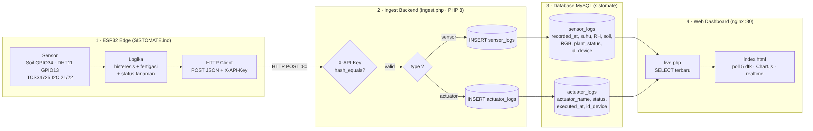
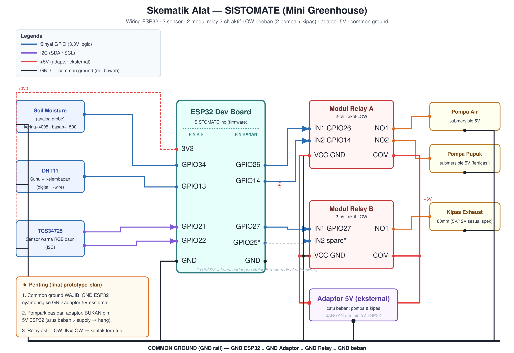
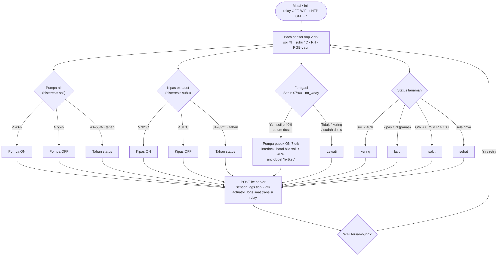

# SISTOMATE: Sistem Otomasi Penyiraman dan Monitoring Kesehatan Tanaman Tomat Berbasis IoT

  

  <b>Smart Precision Agriculture & Automated Mini Greenhouse for Tomato Crops</b> 
  Laporan Proyek Bersama: Workshop Basis Data (TRK 130805) & Workshop Sistem Tertanam 
  Program Studi Teknologi Rekayasa Komputer, Jurusan Teknologi Informasi 
  Politeknik Negeri Jember (2026/2027)

  
  
  
  
  
  

---

## 📖 Tentang SISTOMATE

**SISTOMATE** adalah sistem otomasi penyiraman, pemupukan (fertigasi), dan pemantauan mikroklima tanaman tomat berbasis *Internet of Things* (IoT) yang terintegrasi secara langsung dengan basis data relasional. Sistem ini diimplementasikan pada miniatur greenhouse tunnel busur berukuran $100 \times 80 \times 60\text{ cm}$ untuk memecahkan empat kelemahan utama metode pengamatan visual manual:

1. **Menghilangkan Bias Subjektif:** Menggantikan taksiran mata manusia dengan pembacaan objektif sensor spektrum warna daun TCS34725 (RGB).
2. **Mencegah Keterlambatan Penanganan:** Intervensi dini penyiraman otomatis dan pengaturan ventilasi sebelum tanaman mengalami klorosis atau layu permanen.
3. **Mengatasi Keterbatasan Fisik:** Monitoring jarak jauh secara terpusat tanpa mengharuskan pekebun memeriksa fisik tanaman satu per satu setiap hari.
4. **Pencatatan Riwayat Data Historis:** Seluruh pembacaan sensor dan aksi aktuator tersimpan rapi dalam basis data relasional MySQL untuk evaluasi agronomis berkala.

---

## 🏛️ Arsitektur Sistem Empat Lapis

  

1. **Lapisan Persepsi & Aktuasi (Edge Hardware):** ESP32, sensor kelembapan tanah kapasitif, DHT11 (suhu & RH), TCS34725 (RGB daun), pompa air submersible, pompa pupuk fertigasi, dan exhaust fan 80mm.
2. **Lapisan Penyerapan (Ingestion Backend):** Nginx & PHP 8 endpoint (`ingest.php`) dengan validasi `X-API-Key` dan sanitasi prepared statements.
3. **Lapisan Penyimpanan (Relational Database):** MySQL database `sistomate` dengan skema terpusat pada perangkat (*devices-centric*) yang mencakup 5 tabel.
4. **Lapisan Penyajian (Presentation Dashboard):** Web dashboard realtime berbasis Chart.js dan Canvas Gauge yang membaca status telemetri melalui `live.php`.

---

## ⚡ Skematik Perangkat Keras & Wiring

  

* **Catu Daya Terpisah & Common Ground:** Beban dinamis (pompa air, pompa pupuk, dan kipas) dialiri adaptor 5V eksternal terpisah (bukan dari pin 5V ESP32) untuk mencegah drop tegangan (*brownout/restart*), dengan seluruh rail ground (GND ESP32, GND adaptor, GND relay, dan GND sensor) tersambung pada satu jalur **Common Ground**.
* **Driver Relay Aktif-LOW:**
  * Modul Relay A (CH1): Pompa Air $\to$ GPIO 26
  * Modul Relay A (CH2): Pompa Pupuk Fertigasi $\to$ GPIO 14
  * Modul Relay B (CH1): Kipas Exhaust $\to$ GPIO 27
  * Modul Relay B (CH2): Cadangan $\to$ GPIO 25
* **Sensor Bus:**
  * Sensor Kelembapan Tanah (Analog Input) $\to$ GPIO 34
  * Sensor Suhu & Kelembapan DHT11 $\to$ GPIO 13
  * Sensor Warna RGB TCS34725 $\to$ I2C (SDA GPIO 21, SCL GPIO 22)

---

## 🔄 Flowchart Logika Firmware

  

* **Histeresis Penyiraman (Pompa Air):** ON saat Kelembapan Tanah $< 40\%$, OFF saat Kelembapan Tanah $\ge 55\%$.
* **Histeresis Ventilasi (Kipas Exhaust):** ON saat Suhu Udara $> 32^\circ\text{C}$, OFF saat Suhu Udara $\le 31^\circ\text{C}$.
* **Jadwal Fertigasi Presisi:** Dosis larutan pupuk cair dijalankan otomatis $1 \times$ per minggu setiap hari **Senin pukul 07:00 WIB** (NTP sinkron) selama **7 detik**, dengan interlock pengaman: fertigasi hanya boleh aktif jika kelembapan tanah $\ge 40\%$.

---

## 🗄️ Struktur Basis Data Relasional

Sistem menggunakan 5 tabel relasional dengan integritas referensial `ON DELETE CASCADE` / `RESTRICT`:
* **`users`:** Menyimpan akun pengelola dan hak akses dashboard.
* **`devices`:** Entitas sentral yang merepresentasikan mikrokontroler ESP32 terpasang.
* **`sensor_logs`:** Pencatatan deret waktu (*time-series*) suhu, RH, soil moisture, nilai RGB, dan status klasifikasi kesehatan tanaman.
* **`actuator_logs`:** Audit log pencatatan setiap transisi aksi aktuator (ON/OFF) beserta timestamp eksekusi.
* **`gallery`:** Metadata dokumentasi visual tanaman tomat yang ditangkap oleh webcam.

---

## 📐 Spesifikasi Fisik Greenhouse Mini ($100 \times 80 \times 60\text{ cm}$)

* **Bentuk:** Tunnel busur (setengah lingkaran segmental / *hoop greenhouse*).
* **Rangka Pondasi:** Balok kayu kaso $100 \times 80\text{ cm}$.
* **Busur Atap:** 4 batang pipa PVC fleksibel $\frac{1}{2}"$ sepanjang $149\text{ cm}$ per busur (tinggi puncak $60\text{ cm}$).
* **Selimut:** Plastik PE bening fleksibel tahan embun.
* **Berkas Model 3D:** Tersedia lengkap dalam format `.FCStd` (FreeCAD native), `.step`, dan `.stl` di direktori `docs/cad/`.

---

## 👥 Tim Pengembang (Kelompok 3 Golongan B)

| No | Nama Anggota | NIM |
|:--:|---|:---:|
| 1 | **Yuda Maredya Ari Pratama** | E43252953 |
| 2 | **Abiyu Ammar Hady** | E43252782 |
| 3 | **Ibror Yusron S** | E43252690 |
| 4 | **Moch Calvin Aprilian** | E43252720 |
| 5 | **Nabil Laudza Nur** | E43252939 |
| 6 | **Tio Dwi Harianto** | E43252983 |

### Dosen Pengampu:
* **Zilvanhisna Emka Fitri, S.T., M.T.** (Workshop Basis Data)
* **Nanik Anita Mukhlisoh, S.ST., M.T.** (Workshop Basis Data)
* **Yogiswara, S.T., M.T.** (Workshop Sistem Tertanam)

---

## 📄 Lisensi

Proyek ini dilisensikan di bawah lisensi **MIT**. Silakan baca berkas [LICENSE](LICENSE) untuk informasi lebih lanjut.
