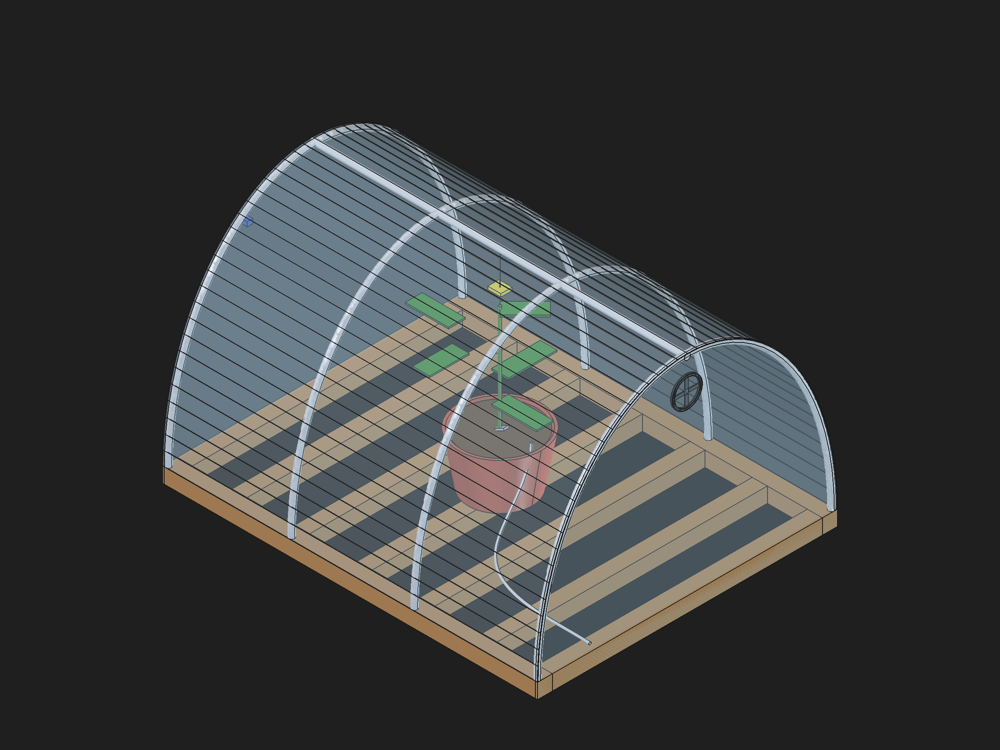
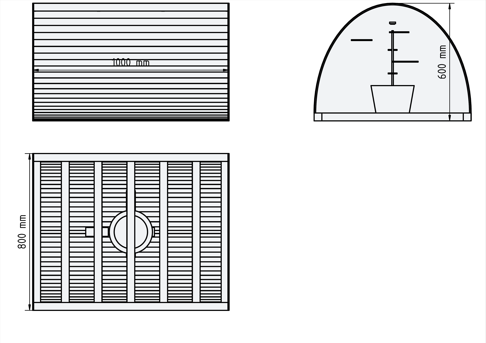

# Panduan Perakitan SISTOMATE — Mini Greenhouse Tunnel Busur

> Dokumen kerja S2 (Implementer & Coder), 27 Okt 2026.
> Sumber desain: [`docs/prototype-plan.md`](prototype-plan.md) (keputusan final 26 Okt 2026).
> Dimensi acuan: **footprint 100 × 80 cm, tinggi puncak 60 cm**.
>
> **Konvensi sumbu (samakan dengan model 3D S1):** X = panjang 1000 mm · Y = lebar 800 mm · Z = tinggi 600 mm. **Dinding belakang = X=1000** (sisi ujung selebar 80 cm, bukan sisi panjang). Busur melintang sumbu Y (span 80 cm) dan disebar di sepanjang X (100 cm).

---

## 1. Bill of Materials (BOM) & Budget

### 1a. Belanja baru (belum dibeli)

| # | Item | Spesifikasi | Qty | Est. Harga (Rp) | Catatan |
|---|------|-------------|-----|-----------------|---------|
| 1 | Pipa busur | PVC/paralon 1/2" atau PP fleksibel, ±4 m/batang | 2 batang (~8 m) | 2 × 25.000 = **50.000** | 1 busur ±150 cm → 4 busur = 6 m; 2 batang cukup (sisa buat cadangan/klem) |
| 2 | Kayu reng alas | Reng/kaso 2×3 atau bekas sisa | ~7 m | **90.000** | Total potong 6 m (lihat §2a) + cadangan; kayu bekas kalau ada → 0 |
| 3 | Plastik PE/terpal bening fleksibel | PE bening 0,1–0,2 mm, ±1,5× luas selimut | 2 × 2 m | **60.000** | BUKAN mika rigid — harus bisa ditekuk ikut busur |
| 4 | Modul relay 2-ch (unit ke-2) | 2 relay, aktif-LOW, optocoupler | 1 unit | **25.000** | Unit ke-1 sudah ada → total 4 kanal |
| 5 | Kipas exhaust 80 mm | 80 × 80 × 25 mm, 12V DC | 1 pcs | **35.000** | Alternatif 60 mm 5V (~25.000) kalau mau satu adaptor |
| 6 | Selang silicone ID 6 mm | Inner diameter 6 mm | 3 m (2 m + 1 m cadangan) | 3 × 8.000 = **24.000** | Press-fit ke outlet pompa 6 mm |
| 7 | Adaptor 5V (catu beban) | 5V ≥ 2A (charger HP bekas boleh) | 1 pcs | **50.000** | WAJIB terpisah dari pin 5V ESP32 |
| 8 | Kabel ties | 100 pcs / pak | 1 pak | **5.000** | Nyekruk selang & kabel ke rangka |
| 9 | Bracket/klem penyangga | Bracket rel kecil / klip bekas / 3D print | 3 pcs | **30.000** | Buat TCS34725, DHT11, penyangga busur |
| 10 | Sekrup & klem busur | Sekrup kayu + klem pengikat pipa | 1 set | **20.000** | Pengikat ujung pipa ke rangka kayu |
| 11 | Kabel pasif 22 AWG | Untuk jarak relay ↔ pompa/kipas/ESP32 | 5 m | **15.000** | |
| | | | **Subtotal baru** | **≈ 404.000** | |

### 1b. Barang yang sudah ada (tidak beli)

| Item | Status |
|------|--------|
| ESP32-CAM + modul ESP32 | ✅ Sudah ada, teruji demo 22 Okt |
| Modul relay 2-ch unit ke-1 | ✅ Sudah ada (CH1 pompa air GPIO26, CH2 pompa pupuk GPIO14) |
| Pompa submersible 5V | ✅ Sudah ada, outlet 6 mm |
| Reservoir air & larutan AB mix | ✅ Sudah ada |
| Sensor DHT11, TCS34725, soil moisture | ✅ Sudah ada |
| Kabel USB, jumper, sensor lain | ✅ Sudah ada |
| Dripper/nipple | ⭕ Opsional (~10.000) kalau mau rapi |

**Total anggaran belanja baru: ≈ Rp 404.000** (±Rp 400–450.000 dengan cadangan).

---

## 2. Cutting List (Daftar Potong Bahan)

### 2a. Kayu rangka alas (kayu reng 2×3)

| Potong | Ukuran | Qty | Fungsi |
|--------|--------|-----|--------|
| Panjang sisi | **100 cm** | 2 | Sisi panjang alas (sisi kanan-kiri) |
| Lebar sisi | **80 cm** | 2 | Sisi lebar alas (sisi depan-belakang) |
| Tiang dinding ujung | **60 cm** | 4 | 2 tiang per dinding ujung (depan & belakang), tinggi = tinggi puncak greenhouse |

> - Rakit alas jadi kotak 100 × 80 cm (sekrup sudut).
> - Dinding ujung: 2 tiang berdiri di sudut tiap ujung + palang silang/silang atas sesuai selera, tinggi maks 60 cm di titik puncak (ujung busur masuk di sini).
> - Total kayu: **6 m** reng (2×100 + 2×80 + 4×60 = 600 cm; beli ~7 m termasuk cadangan, sisa potongan dipakai buat dudukan/kaki).

### 2b. Pipa busur (PVC/PP 1/2")

| Potong | Panjang | Qty | Catatan |
|--------|---------|-----|---------|
| Busur utama | **±150 cm/batang** | 4 | Span lebar **80 cm**, tinggi puncak **60 cm** (busur segmental). Terukur di model 3D: lengkung busur = **149 cm** → total 4 busur ≈ 6 m |
| (sisa potongan) | bebas | — | Sisa dipakai buat klem/penyangga |

> **Cara dapat panjang busur:** pipa ditekuk sampai ujung-ujungnya menempel pada span 80 cm di alas kayu dan puncak menyentuh 60 cm — panjang lengkung inilah ±150 cm. Tandai titik tekuk sebelum potong supaya ke-4 busur identik. Jangan potong lurus 150 cm lalu nebak: **tekuk dulu di tempat, ukur lengkung, baru potong**.

### 2c. Plastik selimut (PE/terpal bening)

| Potong | Ukuran | Catatan |
|--------|--------|---------|
| Selimut busur (melintang busur) | **±160 cm** (lengkung busur 149 cm terukur di model 3D + 5 cm kiri-kanan buat klem) | Lebar ini ikut lengkung busur |
| Panjang selimut (sepanjang 100 cm alas) | **±130 cm** (100 cm + 15 cm depan + 15 cm belakang buat dilipat/diklem) | 1,5× luas selimut termasuk sisi miring |

> Bentangan plastik kira-kira **160 × 130 cm per lembar**; kalau roll-nya kurang lebar, sambung dengan lipatan + klem/kabel ties (bukan lem — harus bisa dibuka).

---

## 3. SOP Perakitan Langkah-demi-Langkah

### Persiapan
- [ ] Siapkan semua item BOM (cek daftar §1).
- [ ] Alat: obeng, palu, gergaji kayu/pipa, meteran, cutter, tang, solder (opsional).
- [ ] **Keselamatan:** elektronik (ESP32, relay, adaptor) **di luar** area basah — jangan pernah colok pompa/kipas ke pin 5V ESP32.

### Langkah 1 — Rakit alas kayu
1. Potong kayu sesuai Cutting List §2a (2× 100 cm, 2× 80 cm).
2. Susun jadi kotak 100 × 80 cm, sekrup di setiap sudut.
3. Pasang 4 tiang dinding ujung (60 cm) di 4 sudut — depan & belakang.
4. (Opsional) Tambah palang pengunci di dinding ujung biar kaku.

### Langkah 2 — Tekuk & pasang busur pipa
1. Potong 4 pipa busur ±130–150 cm (lihat catatan §2b — tekuk dulu, ukur, potong).
2. Tekuk tiap pipa, pasang ujungnya ke alas kayu dengan sekrup/klem di sisi panjang (100 cm) — renggangkan di 4 titik sepanjang 100 cm (jarak antar busur ±33 cm, model 3D: 32,8 cm).
3. Puncak tiap busur harus setinggi **60 cm**. Ratakan tinggi puncak semua busur.
4. Ikat puncak-puncuk busur dengan kabel ties/penyangga silang supaya gak meleset saat selimut ditarik.

### Langkah 3 — Pasang selimut plastik
1. Bentangkan plastik PE/terpal (§2c) melintang busur.
2. Tarik merata dari puncak ke sisi kiri-kanan, sisakan ±15 cm kelipat ke bawah di depan & belakang.
3. Klem/kunci plastik ke rangka dengan klem busur atau kabel ties (lubangi plastik di titik ikat — jangan sobek besar).
4. Pastikan busur membentuk lengkung landai → air embun turun menyusuri lengkung ke sisi, bukan netes ke daun.

### Langkah 4 — Pasang exhaust fan & selang
1. **Kipas 80 mm** dipasang di dinding atas belakang (potong lubang 80 mm di plastik + penyangga kayu), menghadap keluar (exhaust).
2. Alirkan kipas **menjauhi** sensor DHT11 (DHT jangan kena hembusan langsung — pelajaran gladi).
3. Selang silicone 6 mm: masuk dari bawah dinding belakang (lubang kecil tembus dinding), jalankan ke dalam menuju pot → pasang dripper/nipple (opsional).
4. Sisa selang + pompa + reservoir **di luar** greenhouse.

### Langkah 5 — Pasang bracket TCS, DHT11, soil probe
1. **Soil moisture probe** → colok **mendatar/nyaris miring** ke media tanah, kedalaman ±3–5 cm — JANGAN tegak nempel dasar pot (air ngendap → kebaca "selalu basah").
2. **DHT11** → depan-atas **sisi kiri** (±5 cm di atas titik daun tertinggi; model 3D: X=6–26 mm dari dinding depan, Z≈51 cm), **diagonal/berlawanan sama kipas exhaust**, jauh dari tetesan selang.
3. **TCS34725** → bracket di rangka atas (puncak busur), ngadap ke bawah, jarak **3–5 cm** dari titik paling lebar daun; bracket agak tinggi biar ada ruang tumbuh.

### Langkah 6 — Penarikan kabel ke box kontrol luar & common ground
1. Semua sensor & kabel ESP32 ditarik **keluar** lewat lubang tembus kecil di dinding belakang bawah.
2. Pasang box kontrol **di luar** greenhouse: ESP32 + 2 modul relay + adaptor.
3. **Wiring relay** (lihat arsitektur daya di `prototype-plan.md`):
   - Modul A (unit ke-1): CH1 → pompa air (GPIO26), CH2 → pompa pupuk (GPIO14)
   - Modul B (unit ke-2): CH1 → kipas exhaust (GPIO27), CH2 → cadangan (GPIO25)
   - VCC kedua modul ← 5V, IN ← pin ESP32 masing-masing
4. **Common ground WAJIB nyambung:** GND adaptor beban = GND modul relay = GND ESP32 (satu titik).
5. **Adaptor 5V terpisah** hanya untuk beban (pompa/kipas): COM adaptor → COM relay, NO relay → +pompa/kipas, − beban → GND adaptor.
6. Jangan sekali-kali colok beban ke pin 5V ESP32 (arus beban 200 mA–1 A > supply ESP32 ~500 mA → hang/restart).

### Langkah 7 — Uji fungsi
- [ ] Nyalakan ESP32 + adaptor beban, cek WiFi nyambung.
- [ ] Tes relay 4 kanal satu-satu (pompa air, pompa pupuk, kipas, cadangan).
- [ ] Cek bacaan sensor: soil, DHT11, TCS34725 di dashboard.
- [ ] Cek aliran selang tidak bocor; kipas mengeluarkan udara dari dalam ke luar.
- [ ] Simpan firmware/upload ulang jika perlu (`arduino-cli upload -p /dev/ttyUSB0 --fqbn esp32:esp32:esp32 sistomate-firmware/SISTOMATE`).

---

## 4. Slot Gambar (placeholder — tinggal ditempel hasil render S1)

**Render dimensi (technical drawing A4 — 1000 × 800 × 600 mm):**

> **Catatan untuk S1:** kedua gambar di atas diambil dari `docs/cad/render-isometric.png` dan `docs/cad/render-dimensi.png` (hasil export FreeCAD, rencana di `docs/cad/PLAN.md`). File udah ada — tinggal ganti kalau di-render ulang dengan nama sama.

---

*Status: direview Tech Lead (S1) 28 Okt 2026 — audit model 3D cocok, revisi: kayu 7 m, pipa 2 batang, plastik 160 cm, busur 149 cm. Menunggu harga aktual pas setelah belanja.*
